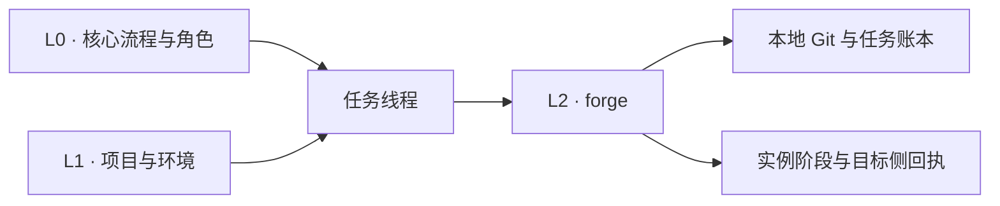
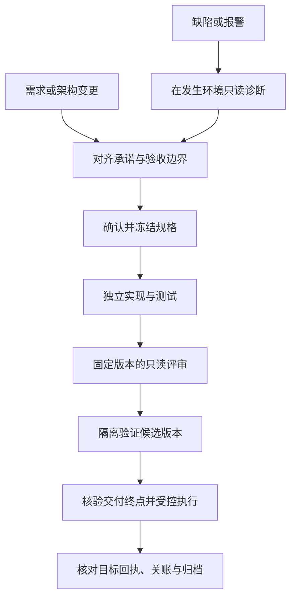

# forge-kit

forge-kit 是面向 Codex 的本地工程工作台。一个实例可以管理一个或多个 Git 仓库，从确认需求到核验交付，保留每项正式任务的规格、版本、评审和回执。

这个仓库同时用 forge-kit 开发自身。下游工作台可以选择自己的验证环境、交付终点和关注域。

## 工作台与项目

单仓可以把工作台直接放在项目根目录。此时 `.` 就是实际项目，领域卡可以描述该仓中的某个模块。

多个兄弟项目共用上层工作台。当前目录承载独立子项目（包括 Git 子模块）时，它就是逻辑组织位置，领域属于各真实项目。一次只关注其中一个项目，仍沿用该项目的仓名。

每个工作台使用一个 Forge 实例。个人地图、任务规格、审计归档和本地策略都归该实例管理。

## 三层架构

| 层 | 职责 | 使用时回答的问题 |
|---|---|---|
| L0 核心骨架 | 定义开发主线、各角色的职责、证据要求及扩展边界 | 何时需要人工裁决，凭什么进入下一阶段？ |
| L1 工作台实例 | 选择项目、关注域、验证环境、交付终点与阶段工具 | 这项任务在哪个仓验证，交付到哪里？ |
| L2 引擎与 CLI | 读取事实，运行探针、校验与受控动作，持久化账本及回执 | 检查的版本是什么，目标端实际发生了什么？ |

L0 以简短的工作约定和 Skill 表达流程。L1 将这些约定连接到实际工作环境。L2 提供可从命令行复核的结果，供工作线程、独立评审和实例工具共同使用。



扩展入口分别承载验证、交付和目标状态观察。只读扩展可以查询项目事实或回执；执行写入的阶段按实例配置及本次授权运行。后续接入新的环境或只读事实来源时，仍可复用同一套版本与回执关系。

## 开发主线

临时查数、日志分析和沟通可以直接处理。正式开发以一项任务、一个工作线程和一本账本组织；跨仓任务登记每个仓的分支与版本。



### 确认与冻结

完整模式从可观察的业务承诺开始。操作者确认 SSOT 并授权开工后，两个独立上下文分别派生技术规格和测试规格。独立评审通过、承诺及风险边界一致后冻结三份规格。

局部而单纯的变更可以走轻量模式，前提是核心不变量和关键契约稳定，且主干已有测试覆盖。范围和补充用例一起确认，后续仍按主线完成评审与验证。

缺陷先从问题发生的环境取证，再对照既有承诺判断影响。涉及权益、授权或业务边界时由操作者裁决。已冻结的承诺发生变化，需要记录修订并重新验证受影响的部分。

### 实现、评审与验证

实现作者和测试作者分别依据冻结输入推进。测试从公开入口检查行为，保留成功、失败与可恢复路径的断言。

原生只读评审角色在独立上下文检查固定提交。四个维度分别关注：

- **业务**核对调用者实际得到的结果与冻结承诺。
- **质量**检查失败处理、状态一致性和存量兼容。
- **简单性与性能**检查实现成本以及受支持负载下的表现。
- **注释与接口文档**核对说明和示例与实现是否一致。

主线程按版本区间保存原始报告，并登记角色、会话和结论。修复后优先请原审稿人复核增量。交付前应有连续覆盖基线到候选版本的评审证据，已启动角色的阻断项均需解除。

验证在候选 SHA 的隔离检出执行项目声明的检查与测试。回执区分实际执行、编译、失败及缺失证据；历史版本或特殊数据可以通过已校验的本地夹具进入验证环境。

### 交付与关账

交付先确定仓库、版本、目标和动作，按获批范围执行，再从目标侧读取结果。不同实例可以选择不同终点。

| 交付形态 | 核验依据 |
|---|---|
| PR 合并 | 候选 HEAD、所需检查、合并结果与目标引用 |
| 直接推送主干 | 获批的快进更新及远端实际 SHA |
| 多任务见证移交与批量发版 | 各任务的 PR 见证、批次中的版本及逐项回执 |
| 实例 CI/CD | 阶段动作及目标环境观察到的作业状态和版本 |

快轨允许在范围和终点明确时前置授权。执行仍核对实际版本、时效、评审、验证和外部状态；发生漂移时保留已取得的回执。

## 按需活地图

薄仓卡保存稳定工程契约和个人关注域索引，薄领域卡保存实体、入口、持久化边界和已知债务。接手陌生模块时可以先局部测绘，一次性小修也可直接使用扫描结果。

扫描器离线读取目录、工具清单和 Git 历史。关注路径的探针给出客观状态，由 apply Skill 结合卡片和必要的变更上下文作语义判断。

| 状态 | 如何使用 |
|---|---|
| UNCHANGED | 基线与当前提交在锚点的快照一致，可读旧卡 |
| CHANGED | 查看有界变更摘要，决定沿用、微调还是重建 |
| BROKEN | 核对不可达基线或已消失的锚点，重建或归档 |
| UNMAPPED | 按需聚焦该路径，决定是否建卡 |

日常健康检查关心卡片结构、路径和索引。个人需要查看全部关注域时再查询总览。扫描产生的验证动作与敏感路径建议，经确认后才进入实例配置。

## 任务证据与安全边界

账本关联冻结输入、分支与提交、评审区间、验证结果和交付回执。换线程接手时，可以据此还原当前阶段及尚待核实的事项。

常规关账自动归档。黑匣子保留经过脱敏的事件及有界工具摘要；成本报告汇总可观察到的角色、阶段和模型用量，并标明历史记录的覆盖情况。

Guard 为受保护分支、敏感操作和审批节点提供薄安全带。实际命令权限来自执行平台和目标系统，分支保护、所需 CI 及生产凭据由部署方配置。

## 本地开始

在工具源码目录构建 CLI，将当前版本的入口加入本次 shell 的 PATH：

```bash
bun install --frozen-lockfile
bun run build
export PATH="$PWD/bin:$PATH"
```

在同一 shell 中切换到要管理的 Git 项目根目录，初始化单仓工作台并登记该项目：

```bash
forge init . --name my-workbench
forge add-repo . --workbench .
forge doctor .
```

多仓布局在共同上层目录初始化，再逐个登记已有子仓。已初始化的工作台从根目录运行：

```bash
export PATH="$PWD/.workbench/bin:$PATH"
forge instance list --json
forge apply --json
forge apply status --json
```

在本仓可用 `forge apply --focus src/audit --json` 查看审计模块的局部骨架与共改邻居。运行 `forge --help` 查看命令入口；现有工作台使用候选工具的 `forge sync` 更新托管资产，实例配置与个人地图保存在本地。
