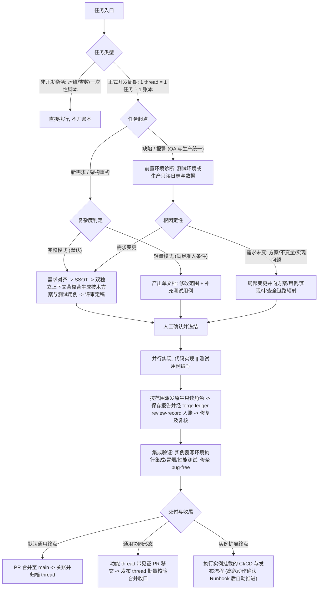

# forge-kit

面向 **Codex CLI** 的自包含多仓工程工作台工具集，基于 **Bun + TypeScript** 与 **SQLite（WAL）** 构建。

本文档定义 `forge-kit` 的架构分层、开发主流程与工具边界，作为项目的核心规范。

---

## 核心特性

- **人机协同**：人工负责关键节点确认，确认后由 Codex CLI 自动完成实现、审查、验证与交付。
- **自包含工作台**：项目级配置覆盖全局配置，可在任意空目录初始化重建。
- **单任务单线程**：每个正式开发任务对应独立的 Codex thread 与任务账本，交付后关账归档。
- **三层解耦**：核心流程与具体项目/CI/CD 环境解耦，环境与工具差异通过实例覆写层扩展。

---

## 三层架构

| 层级 | 职责 | 边界 |
|---|---|---|
| **L0 · 核心骨架（Core）** | 定义通用开发主线、质量约束、任务账本、薄安全带与标准扩展点 | 零业务/公司耦合，不写死具体测试环境与发版流水线 |
| **L1 · 实例覆写（Instance）** | 定义具体工作台的仓库卡、集成验证环境、CI/CD 交付终点、阶段工具与配置覆写 | 不写入宪法（`AGENTS.md`），由 `forge` 统一暴露给工作 thread 动态调用 |
| **L2 · 引擎与 CLI（`forge`）** | 提供统一命令行入口、独立审查引擎、任务账本与安全守卫 | 职责单一，不互相侵入核心逻辑 |

### L0 标准扩展点

核心层向实例层开放三类覆写点：
1. **集成验证环境与验证手段**：测试执行环境（如远端集成环境、容器环境、本地沙箱）及验证命令。
2. **交付终点与 CI/CD 环节**：主分支合并之外的多环境部署、标签发布、数据变更与线上验收步骤。
3. **阶段级工具与配置**：各开发阶段可挂载的自定义工具、模型档位与策略配置。

### L2 核心组件

- **统一入口（`forge`）**：向工作 Codex thread 统一暴露工作台能力与实例覆写配置。
- **原生只读评审角色**由 Codex 在独立上下文中运行。`forge sync` 依据实例的 `.workbench/models.toml` 渲染 `.codex/agents/reviewer-*.toml`。工作 thread 选择角色并派发固定提交范围，保存报告后通过 `forge ledger review-record` 登记，用 `forge ledger reviews` 查询历史。
- **任务账本（`ledger`）**：仅用于正式开发周期（1 任务 = 1 账本，支持归档与清理），通过被动检查机制记录客观事实、防止遗漏或跳步。
- **安全守卫（`guard`）**：针对不可逆高危动作（未授权生产库写入、保护分支推送、未审批发版）的薄安全带。

---

## 开发主流程



### 阶段规则说明

#### 1. Paperwork 分档规则
- **完整模式（默认）**：
  - 沉淀三份产物：**SSOT（业务不变量与衍生流程）**、**技术方案**、**测试用例**。
  - **独立生成**：技术方案与测试用例由两个独立上下文的 Agent 分别基于 SSOT 生成，互不参照。
  - **前置评审**：技术方案评审关注**正确性、性能、兼容性、简单**；测试用例评审关注**完备性、正确性**。确认后冻结。
- **轻量模式（严格准入）**：
  - 仅在**同时满足以下全部条件**时启用（边界不清时默认走完整模式或先确认）：
    1. 改动局限且单纯：如纯 UI / 样式 / 文案调整、单实体简单增删改查、简单字段/筛选/排序增补或局部接线；
    2. 不新增也不修改核心业务不变量、关键状态机、跨服务契约、鉴权/资金/核心数据模型；
    3. 主干行为已被现有测试用例覆盖，仅需增补局部用例。
  - Paperwork 合并为单文档：**修改范围 + 补充测试用例**。
  - 确认冻结后的实现、独立 Review、集成验证与交付标准与完整模式完全一致。

#### 2. 实现与测试原则
- 代码实现与测试用例编写双轨并行。
- 刻意减少低性价比单元测试，以**静态检查、语言动态特性检查、契约测试与集成测试**为主。
- 保持代码模块化与清晰逻辑层级，控制单文件与单次迭代变更边界。

#### 3. 四维独立 Review
工作 thread 先用 `forge ledger reviews <task-id>` 核对历史，再按实际改动派发各自独立的只读子代理，默认并行。

1. **reviewer-business** 核对业务流程与冻结规格中的承诺。
2. **reviewer-quality** 从实际调用方检查实现缺陷、失败路径与边界错误。
3. **reviewer-simplify** 检查实现是否可以简化，核实受支持负载下的性能影响。
4. **reviewer-comments** 对照实现核实注释、使用示例和接口文档。

主线程保存各角色的 Markdown 原文，通过 `forge ledger review-record <task-id>` 登记实际范围、结论、会话与报告。修复后由受影响角色逐项复核；交付前，至少有一个角色沿提交链无空洞覆盖任务基线至交付 HEAD，且所有已启动角色均无未解除的评审失败。

#### 4. 集成验证与交付
- 集成验证在实例覆写指定的验证环境中运行集成测试、冒烟测试（按需含性能测试），修复直至 bug-free。
- 默认交付终点为 PR 合并至主分支（`main`）；支持功能 thread 止于带见证的 PR 移交、由发布 thread 批量合并收口。
- 多环境部署、发版标签、数据迁移等 CI/CD 流程由实例层挂载；高风险动作在确认精确 Runbook 后自动推进。

---

## 正交模式：快速通道（同意前置）

快速通道是叠加在开发主线之上的**授权前置模式**，而非独立交付分支：
- 在前期确认实现内容与风险边界后，将后续原本分散在流程中的人工确认前置。
- Codex 按既定主线自动连续推进，直至完成该任务的最终交付终点（包含实例定义的上线环节）。
- 仅在遭遇真实外部阻拦（CI 失败、合并冲突、环境异常）或超出确认边界时中断并交还人工处理。

---

## 快速开始

```bash
# 1. 构建工作台工具集并运行测试
bun install --frozen-lockfile
bun run build
bun run test:all

# 2. 在空目录初始化自包含工作台
./bin/forge init ~/work/my-workbench --name my-workbench --git-org my-org

# 3. 注册业务仓库（自动生成仓库卡并更新配置）
git clone <repo-url> ~/work/my-workbench/backend
./bin/forge add-repo ~/work/my-workbench/backend

# 4. 健康检查与升级同步
./bin/forge doctor ~/work/my-workbench
./bin/forge sync ~/work/my-workbench
```

### 在本仓库自举

```bash
bun install --frozen-lockfile
./bin/forge init . --name forge-kit
./bin/forge add-repo . --workbench .
./bin/forge doctor .
```
